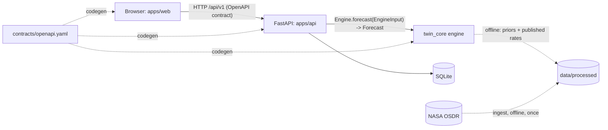

# Architecture and decisions

## What we are building
A **web platform**: a browser app (React) talking to a REST API (FastAPI) that calls a Python
engine (`twin_core`) in-process. Everything runs locally from one container, with **no external
calls at runtime**, so the demo also shows the "works without Earth" story.

## Decisions

| Area | Choice | Why | Rejected alternatives |
|---|---|---|---|
| Shape | Web platform: SPA + API + in-process engine | Judges open a link; three people work in parallel behind a contract | Notebook/Streamlit (weak UI and no clear parallel ownership); desktop app (slower to demo) |
| Contract | OpenAPI 3.0.3, contract-first, code generated for Python and TypeScript | Language-neutral, human-readable, one file to review; mismatches fail at compile/test time | GraphQL/gRPC (more tooling, no gain here); tRPC (TypeScript only) |
| Backend | Python 3.12, FastAPI, Pydantic v2, SQLAlchemy 2, SQLite | Same language as the AI code, so the engine is a function call (no second service to deploy, no serialization drift) | Node/NestJS (forces a Python microservice); Django (heavy) |
| AI/Data | Python; start with NumPy/SciPy/pandas, hierarchical or state-space model with priors from published rates | Honest with tiny data; explainable; fast to iterate. Add PyMC/NumPyro only if time allows | Deep nets (not enough human data, poor uncertainty) |
| Frontend | React 19, TypeScript strict, Vite, Tailwind v4, TanStack Query, openapi-fetch | Types come from the contract; fastest dev loop; largest ecosystem. Add Recharts or ECharts for uncertainty bands | Next.js (SSR not needed); Vue/Svelte (fine, but no gain for this team) |
| Repo | Monorepo, uv workspace, npm for web | One PR can change contract + both sides; one `make check` | Multi-repo (version drift between three people) |
| Quality | ruff + pytest, biome + tsc + vitest, GitHub Actions running `make check` | Same command locally and in CI | Per-person tool choices |
| Persistence | SQLite (swap via `BONETWIN_DATABASE_URL`) | Zero ops | Postgres (not needed for the demo) |

## Integration safety net (why "no mismatch at assembly")
1. Shapes exist once (`contracts/openapi.yaml`); both sides use generated code.
2. `test_contract_parity` fails if the API drifts from the contract.
3. `test_engine_contract` fails if ANY registered engine returns something invalid.
4. `make gen-check` fails if generated files are stale.
5. Ruff bans the backend from importing engine internals.
6. `OWNERSHIP.yaml` + CODEOWNERS: every file has an owner; no orphans.
