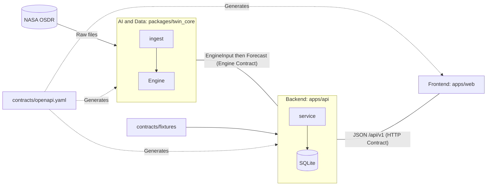

# Who Gives What to Whom (Inputs & Outputs Matrix)

## The Map

## 1) AI and Data

| | Details |
|---|---|
| **Files** | `packages/twin_core/**`, `data/**`, `contracts/fixtures/*.json`, `scripts/make_seed.py`, `docs/SCIENCE_NOTES.md` |
| **Receives** | (1) NASA OSDR data. (2) `EngineInput` from Backend (crew, scenario, measurements, selected countermeasures). (3) Models generated from contract. |
| **Delivers** | `Forecast` to Backend (per-site bone trajectory with 95% uncertainty interval, risks, driver signals, and warnings). Valid contract fixtures. Model card via `model_card()`. |
| **Delivers To** | Backend (everything exposed through `twin_core`). Frontend benefits indirectly via the API. |
| **Commits to Git** | Code, engine contract tests, small processed files in `data/processed`. **Never commits** `data/raw`. |
| **Verification Command** | `uv run pytest packages` |
| **Awaits from Others** | One thing only: The contract. Does not wait for Backend or Frontend. |

## 2) Backend

| | Details |
|---|---|
| **Files** | `apps/api/**`, `Dockerfile`, `docker-compose.yml`, `packages/contracts_py/` (generated) |
| **Receives** | HTTP requests from Frontend. `Forecast` from `twin_core`. `fixtures` for catalogs. |
| **Delivers** | Contract-compliant JSON to Frontend. `EngineInput` to Engine. Measurement persistence. Serves production web build static assets. |
| **Delivers To** | Frontend (HTTP), AI/Data (engine input). |
| **Commits to Git** | Code, tests, Docker configurations. **Never commits** `.env` or database files. |
| **Verification Command** | `uv run pytest apps/api` (includes `test_contract_parity`) |
| **Awaits from Others** | Contract only. Operates from Day 0 against the stub engine. |

## 3) Frontend

| | Details |
|---|---|
| **Files** | `apps/web/**` (except generated `src/api/schema.d.ts`) |
| **Receives** | JSON from `/api/v1/*` using generated types. |
| **Delivers** | Screens: Crew overview, trajectory forecast with uncertainty bands, "what-if" comparison, "About Model" screen (assumptions and limitations), flight surgeon review alert. |
| **Delivers To** | User and Hackathon Judges. |
| **Commits to Git** | Code and small assets. **Never commits** `node_modules` or `dist`. |
| **Verification Command** | `make typecheck`, `npm --prefix apps/web test`, `make lint` |
| **Awaits from Others** | Contract only. Operates from Day 0 against mock/dev API (`make dev-api`). |

## Quick Reference: Who Talks to Whom

| From | To | What | Via |
|---|---|---|---|
| Frontend | Backend | Requests & error messages | HTTP per contract |
| Backend | AI/Data | `EngineInput` then `Forecast` | `twin_core.get_engine().forecast()` |
| AI/Data | Backend | Fixture data for seeding | `contracts/fixtures/*.json` |
| Everyone | Everyone | Any data shape modification | PR on `contracts/openapi.yaml` |

## Core Commands

| Command | Description |
|---|---|
| `make setup` | One-time installation of all dependencies (Python workspace + web deps) |
| `make dev-api` | Start Backend on port 8000 |
| `make dev-web` | Start Frontend on port 5173 |
| `make gen` | Regenerate contract models and CODEOWNERS |
| `make check` | Run all CI checks. Required before every git push |
| `make docker-up` | All-in-one container on port 8000 |

On Windows: Use **Git Bash** or **WSL** to run `make`, or execute commands within the Makefile manually.
